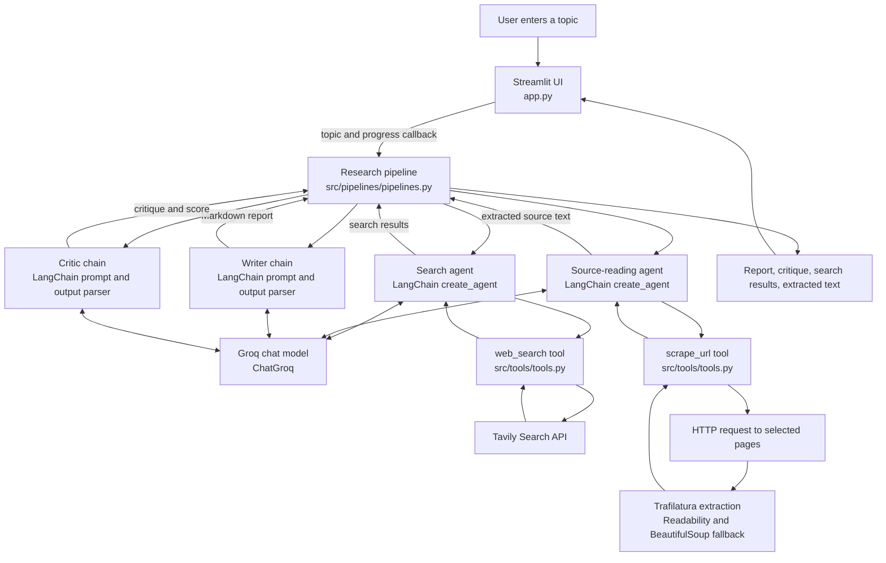

# LangChain-Multi-Agent-Research-System

# LangChain Multi-Agent Research System

Research Desk is a Streamlit application that turns a topic into a sourced research report. Its pipeline searches the web, reads selected pages, drafts a report from the collected evidence, and asks a critic model to review the report.

## Features

- Search for up to five web results with titles, URLs, and snippets.
- Select relevant pages and extract readable page text.
- Draft a Markdown report from the search results and extracted text.
- Generate a critique with an optional score out of 10.
- Browse source links and inspect the search and extracted text in the UI.
- Download the report as a Markdown file.
- Show pipeline progress and report failures in the Streamlit interface.

## Requirements

- Python 3.11
- A [Groq API key](https://console.groq.com/keys)
- A [Tavily API key](https://app.tavily.com/home)
- [uv](https://docs.astral.sh/uv/) for the setup commands below

## Setup

From the project directory, create and activate a virtual environment, then install the dependencies:

```powershell
uv venv --python 3.11
.\.venv\Scripts\Activate.ps1
uv pip install -r requirements.txt
```

On macOS or Linux, activate the environment with:

```sh
source .venv/bin/activate
```

Create a `.env` file in the project root and add your keys:

```dotenv
GROQ_API_KEY=your_groq_api_key
TAVILY_API_KEY=your_tavily_api_key
# Optional; defaults to openai/gpt-oss-20b on Groq.
GROQ_MODEL=openai/gpt-oss-20b
```

Keep `.env` private and do not commit real API keys.

## Run

Start the application from the project directory:

```sh
streamlit run app.py
```

Open the local URL printed by Streamlit, enter a research topic in the sidebar, and select **Run research**. The sidebar shows the active pipeline stage. When the run completes, use the **Report**, **Critique**, and **Sources** tabs to review the output. Select **Download .md** to save the report.

The legacy `main.py` script also invokes the pipeline directly with a hard-coded example topic. For normal use, run `app.py` to use the interactive interface.

## Architecture



## Technology

| Technology | Role in this project |
| --- | --- |
| Python | Implements the agents, tools, pipeline, and application. |
| Streamlit | Provides the interactive Research Desk UI, progress display, result tabs, and Markdown download. |
| LangChain | Creates the tool-using search and source-reading agents, and composes the report and critique prompt/model/parser chains. |
| Groq (`langchain-groq`) | Hosts the shared chat model used by both agents and both text-generation chains. The model name is configurable with `GROQ_MODEL`. |
| Tavily (`tavily-python`) | Returns web search results through the `web_search` tool. |
| Requests | Fetches selected source pages over HTTP. |
| Trafilatura, Readability, Beautiful Soup | Extract readable page text; Readability and Beautiful Soup are used when Trafilatura does not return enough text. |
| python-dotenv | Loads API keys and optional model configuration from `.env`. |

## Pipeline stages

1. **Web search:** The search agent uses Tavily to find up to five results for the topic.
2. **Source reading:** The source-reading agent chooses relevant URLs from those results and calls the page extraction tool.
3. **Report writing:** A LangChain prompt chain asks the Groq model to draft a report using the collected search and page text.
4. **Critique:** A second prompt chain asks the model for strengths, weaknesses, suggestions, references, and a score. A critique failure does not discard an already generated report.

Transient Groq connection failures are retried up to three times. Search availability, model access, and rate limits depend on the configured external services. The scraper extracts public page text and cannot access pages that require authentication or block automated requests.
